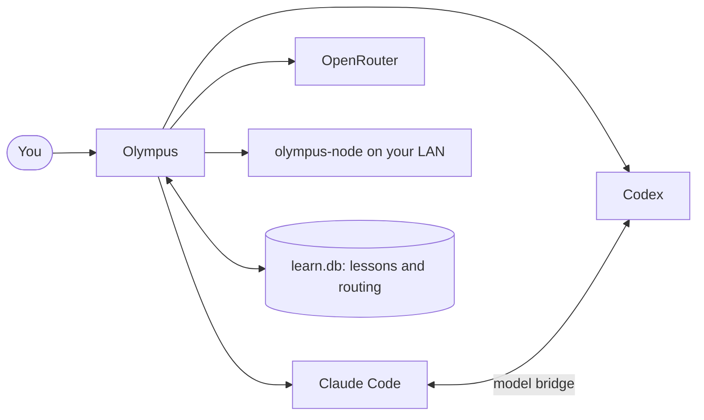

<div align="center">


# Olympus

**Every model you're signed into, working as one team.**

A fast, keyboard-first desktop app for Windows, written in Rust. It runs your signed-in Claude Code and Codex side by side, adds OpenRouter and models on your own network, and learns from your history.

[](https://github.com/RobbinPilhede/Olympus/releases/latest)
[](LICENSE)
[](#get-started)
[](https://www.rust-lang.org)

[Get started](#get-started) · [What it does](#what-it-does) · [Commands](#commands) · [Safety](#safety-and-secrets) · [Build from source](#build-from-source)

<br>


</div>

## Why Olympus

If you pay for more than one AI coding tool, you end up juggling terminals, accounts and quotas. Olympus puts them in one window. Your subscriptions stay as they are, because it drives the real `claude` and `codex` programs you're already signed in to.

- **One window, every model.** Claude, ChatGPT, OpenRouter and your own GPUs, each thread on the account you choose.
- **They work together.** Ask a second opinion mid-chat, have several models debate a decision, or let one build while another reviews.
- **It feels like a CLI.** GPU-drawn with [GPUI](https://gpui.rs), driven from the keyboard, and everything is one `Alt+K` away.
- **It spends fewer tokens.** Lean startup, on-demand skills and cheapest-first routing.
- **It learns from you.** Your past corrections become lessons and finished tasks can become skills, and nothing is used until you approve it.
- **It reaches your phone.** Text your own Telegram bot or send it a voice memo, and get the result back when the work is done.

## Get started

**You need:** Windows 10 or 11 (x64) with an AVX2 CPU, plus at least one of [Claude Code](https://www.anthropic.com/claude-code) or [Codex](https://github.com/openai/codex), signed in.

1. Download [`OlympusSetup.exe`](https://github.com/RobbinPilhede/Olympus/releases/latest/download/OlympusSetup.exe) and run it. It takes one click, needs no admin rights, and adds Olympus to your Start menu and Desktop. The builds aren't code-signed yet, so Windows may show a SmartScreen warning.
2. Press **+ New**, pick an account, pick a folder, and start typing.

**Updates are automatic.** Each time you open Olympus, it plays a short animation while it checks for a new version. If there is one, it downloads it, verifies its checksum, swaps it in and reopens, and you can skip it while it downloads. If you're offline, it just opens. Anything already running keeps working on the old copy until you close it.

**To uninstall,** use Windows's Installed apps. Your threads and settings stay in `~/.olympus`, so delete that folder too if you want them gone.

> [!WARNING]
> Chats run with permissions **bypassed** by default, so agents can edit files and run commands without asking. Read [Safety and secrets](#safety-and-secrets) first.

## What it does

### Pick the account and the folder for each thread

**+ New** asks which account to use, then where to work: your user folder, any folder you browse to, or a recent one.

<p>
  
  
</p>

### Make the models work together

| Type this | What happens |
| --- | --- |
| `take help from ChatGPT on this` | The agent calls the other model itself |
| `@codex is this safe?` | Asks another model read-only, without leaving this chat |
| `/council which queue fits?` | Several models answer independently, then you get one recommendation |
| `/auto add rate limiting` | Plans, builds in parallel worktrees, runs checks, and gets a review from the other vendor |
| `/review` | The other vendor reviews your uncommitted changes |



### Reach it from your phone

Text your own Telegram bot or send it a voice memo, and Olympus replies when the work is done. Olympus has to be open on your PC. It only makes outgoing connections, so nothing on your PC is exposed to the internet, and voice memos are transcribed on your own GPU.

1. In Telegram, message [@BotFather](https://t.me/BotFather), send `/newbot`, and copy the token it gives you.
2. In Olympus, run `/telegram connect <token>`.
3. Send your bot the code Olympus shows. Only that chat can reach Olympus from then on. Everyone else gets silence, and pairing closes after five wrong codes.

In Telegram, `/threads` lists your threads, `/use 2` switches to one, `/new` starts one, `/stop` stops the current work, and `/schedules` lists your schedules. Agents still run with permissions bypassed, so treat your Telegram account as a key to your PC.

### Run things on a timetable

`/schedule daily 08:00 summarize my calendar` or `/schedule every 1h check the deploy` keeps running after a restart, and sends the result to your phone if Telegram is connected. Schedules run while Olympus is open. A run missed while it's closed happens once at the next launch. Each run starts a fresh conversation in that thread, so a daily job doesn't pay for its earlier runs.

### Find anything you've talked about

`/search rate limiting` searches everything said in your past Claude and Codex chats, and picking a result reopens that session. Agents can search it too, through the `search_history` tool. Chats on OpenRouter and network models aren't indexed yet.

### Keep what worked as a skill

After a task that took eight or more steps, Olympus offers to save how it was done. `/save-skill` has a model write a draft and shows it to you. Nothing is used until you approve it with `/keep-skill <name>`, which installs it to `~/.claude/skills` and never replaces a skill you already have. `/drop-skill <name>` deletes a draft.

### Run models on your own hardware

Drag `olympus-node.exe` onto another PC on your network and run it. It serves models from Hugging Face, and Olympus finds it automatically. Use `/nodes` to find one, `/hf qwen3` to download a model, and `/load` to load one you already have.

### Talk and point, from any app

Hold **Shift+V** to dictate into whatever app you're using. It runs on your GPU, works offline after the speech model's first download, and understands Swedish and English. Hold **Shift+C** to screenshot a region, draw on it, and drop it into your message.

### Save tokens

- **Lean startup.** Chats skip unused MCP servers, skills and hooks: about 37k startup tokens drop to about 12k on Claude. `/profile full` restores your whole setup for a chat.
- **Skills on demand.** Agents search your installed skills and load only the one they need.
- **Tiers and routing.** `/auto` tasks and `/model auto` chats start on the cheapest tier that fits. Failed checks escalate to a stronger model.
- **Failover.** When a vendor hits its limit, work continues on the other with a short handoff.
- **Bounded memory.** At most 400 tokens of lessons per session, and 20% of runs get none so the benefit can be measured.

### Learn from your history

- History from `~/.claude` and `~/.codex`, including compressed archives, is read into `~/.olympus/learn.db` in the background. It stores signals, short prompts, and your messages and the replies for search (up to 4,000 characters each), with anything that looks like a key removed. Tool output isn't stored. The file stays on your PC.
- `/learn distill` asks a model to find lasting rules in your corrections. Nothing is used until you `/approve` it.
- Lessons that lead to failures or corrections lose standing and retire on their own. Lessons tied to a file go stale when that file changes.
- `/auto` tasks count as successes only if their checks pass. Chat turns count against a model if your next message corrects it.

## Commands

Everything is reachable from `Alt+K`.

<details open>
<summary><strong>Chats and models</strong></summary>

| Type this | What happens |
| --- | --- |
| Any message | Goes to this chat's model, with permissions bypassed |
| `/model auto` | Routes each new chat by task type and learned results |
| `/account`, `/account add work`, `/account add chatgpt work`, or click a thread's account line | Chooses that thread's Claude or ChatGPT account, or signs in to another. Picking an account on the other provider moves the thread there. Chats and `@` questions use it; `/auto`, `/council` and `/review` use your default accounts |
| **+ New** | Asks which account to start the new chat on, then which folder. `Alt+N` and `/new` start right away on this thread's model, account and folder |
| The thread list | Each thread shows its topic (from your first message, or `/rename`), who it's connected to, and that account's usage. Drag a thread up or down to move it; the order is kept after a restart |
| `/sessions` | Reopens any past Claude or Codex session |
| `/simplify`, `/code-review`, `/my-skill ...` | Runs any installed skill or Claude Code command. On Claude it's the real command, with your full setup for that message. On ChatGPT, nodes and OpenRouter, skills are sent as instructions |
| `/loop 5m check the deploy`, `/loop run tests every 1h`, `/loop stop` | Repeats a message or skill in this thread while Olympus is open. Without a time, the model decides how long to wait. A failed run or `/stop` ends it |
| `/schedule daily 08:00 <message>`, `/schedule every 1h <message>`, `/schedule list`, `/schedule stop 1` | Runs a message or skill on a timetable that survives restarts. It reports in this thread and on your phone |
| `/search <words>` | Finds words in your past Claude and Codex chats, and reopens the session you pick |
| `/save-skill [name]`, `/keep-skill <name>`, `/drop-skill <name>` | Drafts a skill from this chat, then approves or deletes the draft |
| `/telegram connect <token>`, `/telegram`, `/telegram off` | Connects your own Telegram bot, shows its status, or disconnects and deletes its token |
| `/remember always use pnpm` | Teaches Olympus directly |
| `/usage` | Quotas, spend, and whether memory is actually helping |

</details>

<details>
<summary><strong>Code and windows</strong></summary>

| Type this | What happens |
| --- | --- |
| `/merge` | Brings the finished `/auto` branch into your branch |
| `/changes` | Shows this chat's diff beside the conversation |
| `/grid` | Shows up to four windows at once |
| `/claude`, `/codex`, `/term` | The real programs, in a window |
| **Self-improve** in the sidebar, or `/self-improve` | Opens Claude Code in its own window, on Olympus's source, permissions bypassed. `CLAUDE.md` briefs it, and it stays open when Olympus restarts. It needs a build made from a clone of this repo |

</details>

<details>
<summary><strong>Local models</strong></summary>

| Type this | What happens |
| --- | --- |
| `/nodes`, `/hf qwen3`, `/load` | Finds a node, downloads a model and loads it if the node is idle, or loads one you already have |
| `/pf qwen3` | Same as `/hf`, from Pirate Face's listings, a third-party site. It uses the torrent's direct link first, and the torrent network only if that fails, then stops sharing. Only download what you have the right to use |
| `/learn distill` | Turns your past corrections into lessons for you to `/approve` |

</details>

<details>
<summary><strong>Voice, screenshots and files</strong></summary>

| Type this | What happens |
| --- | --- |
| Hold **Shift+V**, or press it twice | Dictate in any app: the text is typed where your cursor is when you stop. Pressing it twice keeps listening with nothing held, until you press Shift+V again. A single tap still types V |
| Hold **Shift+C**, or press it twice | Screenshot in any app: drag a region or click for the whole screen, draw on it with the mouse if you like (`Ctrl+Z` undoes a stroke), then press **Send to Olympus** or Enter. It lands in the message box, unsent. Esc or right-click cancels. A single tap still types C |
| Drag files onto the window, or paste them or an image | Adds them to your next message. `/screenshot` does the same as Shift+C, and `/hotkeys off` frees both keys |
| Pictures in a chat | Pictures a model links to or names by path, and ones you attach, show in the chat. Click one to open it, and click any link to open it |
| `/notify on`, `off`, `test` | A chime when work finishes, plus a Windows notification when you're not on that thread |

</details>

### Keys

| Keys | |
| --- | --- |
| `Alt+K` | Find anything |
| `Alt+1-9`, `Alt+←/→` | Switch windows |
| `Alt+G` | Grid view |
| `Alt+D` | Changes panel |
| `Alt+B` | Show or hide threads |
| `Alt+N`, `Alt+T`, `Alt+W` | New chat, new terminal, close (or the `×` on a thread; `/reopen` brings a closed chat back) |
| `Enter`, `Ctrl+J`, `Esc` | Send, new line, stop |
| Drag, `Ctrl+C` | Select and copy text (`Ctrl+Shift+C` in a terminal) |

## Configuration

Settings live in `~/.olympus/config.toml`, which is created on first run. It holds your model tiers, node addresses, parallel agent limit and quota ceiling.

Keys are never stored in this repo or in the app. Set them in your environment:

| Variable | Used for |
| --- | --- |
| `OPENROUTER_API_KEY` | OpenRouter models (or set `openrouter_key` in `config.toml`) |
| `HF_TOKEN` | Gated Hugging Face models on a node |
| `OLYMPUS_NODE_TOKEN` | The token a node requires. Set the same value as `node_token` in `config.toml` |
| `OLYMPUS_TELEGRAM_TOKEN` | Your Telegram bot's token, instead of the one `/telegram connect` saves in `~/.olympus/telegram.json` |

Your data stays in `~/.olympus`: settings, saved threads, `learn.db`, usage and attachments.

## Safety and secrets

> [!CAUTION]
> Olympus is built for one person on their own PC and trusted network. Read this before you use it anywhere else.

- **Agents run with permissions bypassed.** They can change or delete files and run commands without asking. Point them at folders you can recover, ideally under version control.
- **There's a small block list, not a sandbox.** Before a chat's shell command runs on Claude, Codex, OpenRouter or a node, Olympus refuses the most catastrophic ones: recursively deleting system, home or credentials folders, wiping or formatting a disk, damaging Windows or its backups, and force-pushing over `main`. It catches accidents, not a model determined to get around it. It doesn't cover `/claude`, `/codex`, `/term` or Self-improve windows, or file edits. If a command you really want is refused, run it yourself in a terminal.
- **Change the node token.** A node accepts the default token `olympus` unless you set `OLYMPUS_NODE_TOKEN`. Its firewall rule only allows your local subnet, but anyone on that network who knows the default can use the node.
- **Your Telegram account can run commands on your PC** once it's linked. Keep your bot token private, and use `/telegram off` if you lose your phone.
- **Global hotkeys.** Shift+V and Shift+C use a low-level keyboard hook. `/hotkeys off` turns it off.
- **Automatic updates.** The installed app downloads new versions from this repo's releases over HTTPS and checks each one's SHA-256. The releases aren't code-signed, so you're trusting this GitHub repo. Builds you make yourself, and an `olympus.exe` run from outside the install folder, never update themselves.
- **Your accounts, your terms.** Each provider's terms apply to how you use your subscriptions and models. Olympus isn't affiliated with Anthropic or OpenAI.

## Build from source

You need the Rust toolchain with MSVC, plus CMake, libclang, the Vulkan SDK and `glslc`. Point Cargo at them in either of these ways:

- **Environment variables:** set `CMAKE`, `LIBCLANG_PATH` and `VULKAN_SDK`.
- **A local `.tools` folder (git-ignored):** use `.tools\cmake`, `.tools\libclang` and `.tools\vulkan`.

The node also needs its shader compiler at `.tools\glslc\Bin\glslc.exe`. Neither program needs any of these at runtime.

```powershell
git clone https://github.com/RobbinPilhede/Olympus.git
cd Olympus
cargo build --release
```

The binaries land in `target\release`, and build files go in `C:\ot` to stay under Windows's path length limit. A first build is slow. `scripts\release.ps1` builds and publishes the version named in `Cargo.toml`.

```powershell
cargo clippy --workspace --all-targets
cargo test --workspace                              # opens and closes real Olympus windows
cargo test -p olympus-core --test live -- --ignored # uses your signed-in CLIs and spends a little quota
```

### Project layout

| Path | Purpose |
| --- | --- |
| `crates/olympus` | The desktop interface |
| `crates/olympus-core` | Providers, workflows, the MCP bridge |
| `crates/olympus-learn` | History ingest, lessons, routing |
| `crates/olympus-node` | The LAN model server |
| `vendor/infr` | The pure-Rust inference engine ([infr](https://github.com/kryptic-sh/infr), MIT), embedded in the node |

## License

[MIT](LICENSE). Vendored code and fonts keep their own licenses: see [`vendor/infr/LICENSE`](vendor/infr/LICENSE) and [`OFL.txt`](crates/olympus/assets/fonts/OFL.txt).
